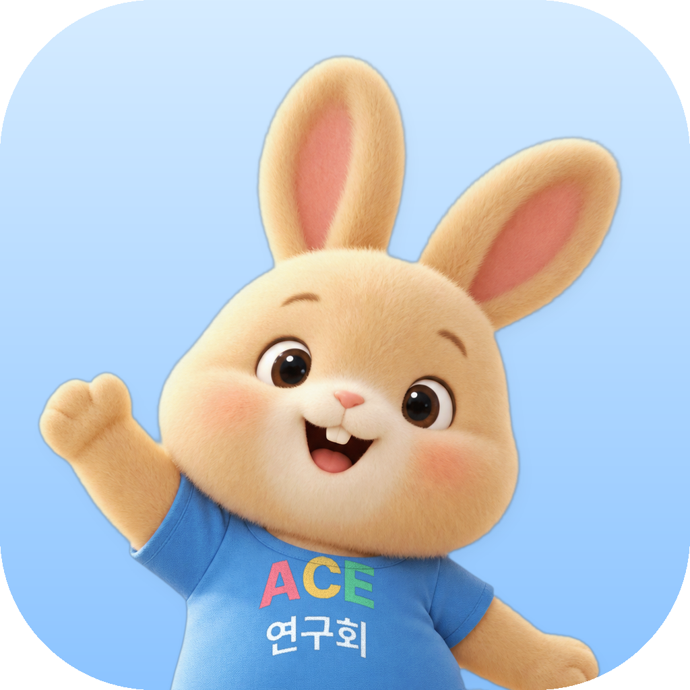
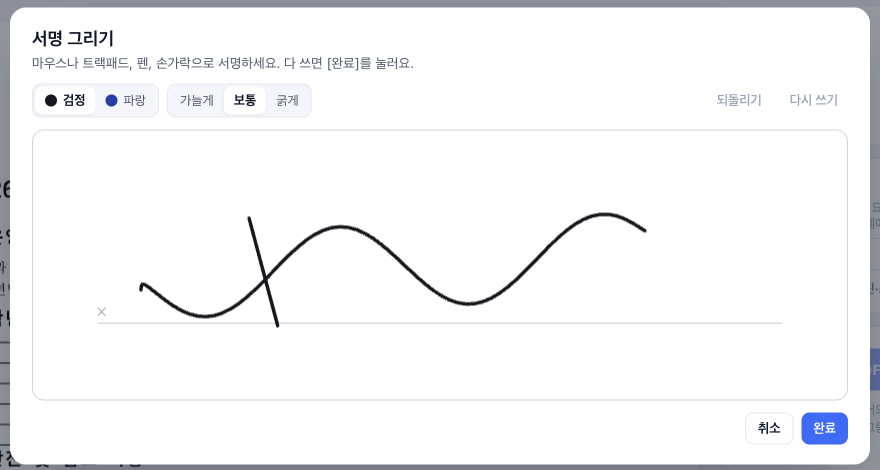
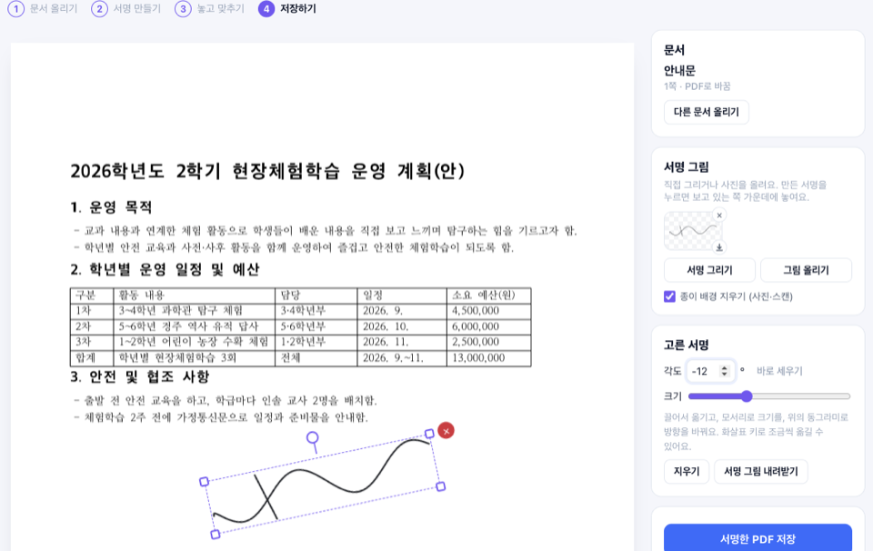

<div align="center">



# ttokttak-workspace (똑딱작업실)

**An open-source AI workspace that takes the busywork out of documents**

Open a Hangul (HWP/HWPX), Word, Excel, PowerPoint or PDF file, say what to change, and the AI edits the document itself.<br />
Try it in the browser, or install it and connect your own AI agent.

[Web trial](https://hangul-ai-workbench-545101783843.asia-northeast3.run.app) · [Built-in AI](#built-in-ai-that-runs-inside-your-computer) · [Latest update](#latest-update) · [Install with an AI agent](#install-with-an-ai-agent) · [한국어](README.md)

</div>

<p align="center"><a href="docs/assets/intro.mp4"></a></p>

## Built-in AI that runs inside your computer

The Apple Silicon (M1+) Mac and Windows (x64, since **v0.16.4**) installers include an AI model. After installing, you can hand Hangul and Word documents to the AI without a subscription, an API key or an internet connection.

**Why built in**

- **Security**: school and office documents hold student names, contact details, budgets and internal approvals. The built-in AI runs only on this computer's `127.0.0.1` and never sends documents or chats to an outside AI server. The app creates a fresh access key on every start and stops the model when it quits.
- **Cost**: outside AI services charge subscriptions or usage fees. The built-in AI has no extra charge after installation, so a whole school can use it.
- **Choice**: for bigger jobs you can still switch to your own Codex or Claude subscription in Settings; that provider's data and billing terms then apply.

**What ships today**: the public **Qwen3.5-2B** model (Apache-2.0) with **똑딱AI third generation**, our document-editing fine-tune trained in three rounds (since 0.16.8; last two layers only, so size and memory match the base), quantized to 4 bits (about 1.28 GB), with the **llama.cpp** runtime. The model file is pinned by SHA-256. Each editor's own tools apply and save the edits, and only edits the editor confirms are kept. A small model can be slow or miss instructions on complex documents, so review the result.

**Our own improved model, step by step**: we train a document-editing specialist that picks the right editor tool and changes only what was asked, on made-up school documents (no personal documents). 0.16.4 shipped the first one, trained on 1,529 examples built from the app's real tool-call records. 0.16.8 ships the third: a teacher model (Google Gemini) worked 1,200 made-up Word and Excel tasks with the app's own editing tools, and only runs whose saved and reopened files were right became its 3,852 training rows, continuing from the second model. On 200 unseen real-file tests the second research model passed 131 and the third 125 (sealed set: 132 and 125); median response time fell from 2.45 s to 2.14 s under the same settings (GPU). It has not yet been compared with the first model on the same tests. Changing parts that were not asked for, and attempting writes on read-only requests, still occur in tests. Each release note says what changed.

The built-in model ships in the **macOS arm64** and **Windows x64** installers; Intel Macs and the web trial keep their existing AI connection options.

## Latest update

<!-- GITHUB-RELEASES:START -->

**[v0.16.7](https://github.com/ARTHONG1/ttokttak-workspace/releases/tag/v0.16.7) · 2026-11-09** — Read the full release notes (in Korean).

[All releases and changes](https://github.com/ARTHONG1/ttokttak-workspace/releases)
<!-- GITHUB-RELEASES:END -->

This section and the [changelog](CHANGELOG.md) update automatically from published GitHub Releases. The same release notes appear in the desktop update dialog.

## New: 문서 변환 (convert a document)

Upload any document, pick the format you want, and download it. Open **똑딱업무 → 문서 변환**.

- The document is checked and the formats it can be made into appear as cards, shorter routes first, each with the steps it goes through (for example Hangul → PDF → one picture per page).
- While it runs the current step is shown; the result comes with a first-page preview and what to check (a scanned page, pages drawn as pictures).
- Every document converts into every other format: PDF, Hangul HWP·HWPX, Word, ODT, PowerPoint, Excel, HTML, Markdown and page pictures (from HTML and Markdown in the desktop app). When no engine converts directly, it goes through another format, for example Hangul → PDF → PowerPoint or Excel → PDF → Word → Hangul; the card lists the steps and says when the layout may change on the way.
- Everything runs on the engines inside 똑딱작업실; HWP↔HWPX is handed out only when the result reads back with the original's text.

## 똑딱서명 (sign a document)

Put a signature into a document without printing, signing and scanning it again. Open **똑딱업무 → 똑딱서명**.

▶ [Watch the 똑딱서명 introduction (49 s)](https://youtu.be/tLxKYB8qInY)

1. **Upload a document**: a PDF, Hangul (HWP/HWPX), Word, Excel or PowerPoint file, or a photo, shown as a PDF, in the app and in the web trial alike.
2. **Make a signature**: draw it on the signature pad with a mouse, trackpad, pen or finger (shaky lines are smoothed, a pen's pressure sets the width), or upload a photo of a signature on paper and the paper is removed. The last three signatures are remembered, and each can be downloaded as a transparent PNG.
3. **Place it**: drag it, size it by a corner or the size slider, turn it freely by the handle or an angle, or put it at the same spot on every page.
4. **Save**: a PDF with the signature drawn into the page (`name_서명.pdf`), the same in every PDF viewer. It is a picture of a signature, not a certificate-based digital signature.

<p align="center">
  
  
</p>

## Why

Most school and office work is document work: opening a file to change one title or a few numbers. ttokttak-workspace is built to take that repetitive work off people with AI, not only to edit documents. You say what to change, the AI changes it inside the document and shows what changed, and you check and decide. It is built on open source, and everything it adds is published back as open source.

## Three ways to use it

|           | Web trial                              | Desktop app                                                           | Installed by your AI agent             |
| --------- | -------------------------------------- | --------------------------------------------------------------------- | -------------------------------------- |
| What      | In the browser, nothing to install     | macOS and Windows                                                     | One prompt does the whole setup        |
| AI        | Google Gemini (web configuration)      | **Built-in AI (Apple Silicon Mac & Windows)**, or Claude Code / Codex | The same agent is connected to the app |
| Documents | Kept only while you work, then deleted | Stay on your PC                                                       | —                                      |

## Install with an AI agent

Paste this into Claude Code, Codex, Gemini CLI, Cursor or another coding agent:

```text
Install ttokttak-workspace on my computer and finish the setup.
Read https://github.com/ARTHONG1/ttokttak-workspace/blob/main/INSTALL.md and follow it exactly.
```

The agent picks the right file for your OS and CPU, downloads it from the official release only, checks it against the release's SHA-512, installs the app, puts a 똑딱작업실 shortcut on the Desktop, links the `ttokttak` command, and registers the MCP server and the document skill with the coding agents on the PC. See [INSTALL.md](INSTALL.md) and `scripts/install/`.

## What it does

- One window for Hangul, Word, Excel, PowerPoint, PDF, Markdown, HTML and XMind files, saved in their own formats.
- An AI panel in every editor that reads, edits, marks the changes and undoes them in one step.
- HWPX saves that Hancom Hangul opens, checked before anything overwrites the original.
- School work tools: a purchase request generator, a quiz maker (Blooket CSV, QuizN XLSX, PDF, video), a word-search worksheet maker, 똑딱서명, which signs a document with a drawn or uploaded signature, and 문서 변환, which turns an uploaded document into any other format, through PDF or Word when needed.
- A command line and MCP server (`ttokttak`, `ttokttak mcp`) for Claude Code, Codex, Cursor, Gemini CLI, Copilot CLI, OpenCode and Windsurf.
- The app runs the Claude Code or Codex program you signed in to; it never reads or stores those logins.

## Privacy

The desktop app has no server of its own and sends no usage statistics; documents stay on your PC, and AI requests go to Anthropic or OpenAI under your own account. The web trial requires a Google sign-in, counts AI requests per account per day, keeps uploaded documents only in a temporary folder while you work (deleted 15 minutes after you leave) and sends AI requests to Google Vertex AI. See [PRIVACY.md](PRIVACY.md).

## Built on open source, published as open source

ttokttak-workspace is not written from scratch. We express our deep respect and gratitude to the creators and maintainers of **[GenOffice](https://github.com/genspark-ai/genoffice)**, **[IeumOffice (이음오피스)](https://github.com/pblsketch/openoffice)**, and **[rhwp](https://github.com/edwardkim/rhwp)**, along with every open-source project listed below, for building and generously sharing the foundation this work stands on.

Building on that foundation, ttokttak-workspace carries the work forward toward two goals: **bundling purpose-built programs for real school and office workflows** right inside the app, and **adding our own fine-tuned built-in AI so people can hand over sensitive documents with no security or privacy worries**.

| Area                 | Open source                                                                                                                                                                                               | Role                                                                                  | Licence          |
| -------------------- | --------------------------------------------------------------------------------------------------------------------------------------------------------------------------------------------------------- | ------------------------------------------------------------------------------------- | ---------------- |
| App base             | [IeumOffice (이음오피스)](https://github.com/pblsketch/openoffice) · [GenOffice](https://github.com/genspark-ai/genoffice) (full attribution in [NOTICE](NOTICE))                                         | Tabbed editors, an AI panel in each editor, subscription connection, document engines | Apache-2.0       |
| Hangul documents     | [rhwp](https://github.com/edwardkim/rhwp)                                                                                                                                                                 | Reading, writing and rendering HWP/HWPX                                               | MIT              |
| Spreadsheets         | [Univer](https://github.com/dream-num/univer) · [calamine](https://github.com/tafia/calamine)                                                                                                             | Calculation and grid, reading Excel files                                             | Apache-2.0 · MIT |
| Word and Markdown    | [Tiptap](https://github.com/ueberdosis/tiptap) · [ProseMirror](https://prosemirror.net)                                                                                                                   | Document editing                                                                      | MIT              |
| PDF                  | [PDF.js](https://github.com/mozilla/pdf.js) · [EmbedPDF](https://github.com/embedpdf/embed-pdf-viewer) (PDFium) · [qpdf](https://github.com/qpdf/qpdf) · [HarfBuzz](https://github.com/harfbuzz/harfbuzz) | Viewing, editing and saving PDF, fonts                                                | Apache-2.0 · MIT |
| Slides               | [frontend-slides](https://github.com/zarazhangrui/frontend-slides)                                                                                                                                        | Basis of the slide design templates                                                   | MIT              |
| Math, diagrams, code | [KaTeX](https://github.com/KaTeX/KaTeX) · [Mermaid](https://github.com/mermaid-js/mermaid) · [CodeMirror](https://github.com/codemirror/dev)                                                              | Formulas, diagrams, HTML source editing                                               | MIT              |
| App runtime          | [Electron](https://github.com/electron/electron) · [React](https://github.com/facebook/react)                                                                                                             | Desktop app and screens                                                               | MIT              |

It also uses 575 bundled open-source components, whose copyright notices and licences ship unchanged. Where each part of the code comes from and what was changed is stated exactly under [License and acknowledgement](#license-and-acknowledgement) and in [NOTICE](NOTICE).

What this project adds: HWPX saves that Hancom Hangul opens and that are validated before they overwrite a file, tables that split between pages, the browser trial edition (`web/`) with Google sign-in and per-account limits, the school work tools ported from the maker's 클래스똑딱 web tools, the agent-driven installer, and a Korean home screen and labels.

## Build from source

```bash
git clone https://github.com/ARTHONG1/ttokttak-workspace.git
cd ttokttak-workspace
npm install
npm run dev
```

Node 22.12+ (npm 10+) and Rust (`cargo` on the PATH) are required. See [CONTRIBUTING.md](CONTRIBUTING.md) for the checks a change must pass, and [llms.txt](llms.txt) for a map of the repository written for AI tools.

## License and acknowledgement

Licensed under the [Apache License 2.0](LICENSE). The code in this repository is a modified version of [IeumOffice (이음오피스)](https://github.com/pblsketch/openoffice) and [GenOffice](https://github.com/genspark-ai/genoffice), both published under the Apache License 2.0; we gratefully keep the original copyright notices as written. Attribution and the summary of changes are in [NOTICE](NOTICE); every change is in the history. ttokttak-workspace is an independent project and is not affiliated with, sponsored or endorsed by the maintainers of the base open-source projects, Genspark / Mainfunc, Inc., Anthropic, OpenAI, Microsoft, Hancom, Adobe, XMind or Google. "GenOffice" and "Genspark" belong to their owners, and the licence grants no trademark rights (section 6). "한글", "한컴", "HWP" and "HWPX" are registered trademarks of Hancom Inc.; other product names belong to their owners and are used only to say what this program opens and works with.

> 본 제품은 한글과컴퓨터의 한글 문서 파일(.hwp) 공개 문서를 참고하여 개발하였습니다.

The rabbit in the app icon is the mascot of ACE 연구회, used with its permission; the base project’s name, icon and logo are not used. The mascot artwork is not covered by the Apache License 2.0; redistributions must replace the icon.

Made by 홍찬우 (Incheon Bongsu Elementary School), who runs the teachers' edtech group [클래스똑딱](https://classddok.com). Issues: [https://github.com/ARTHONG1/ttokttak-workspace/issues](https://github.com/ARTHONG1/ttokttak-workspace/issues).
