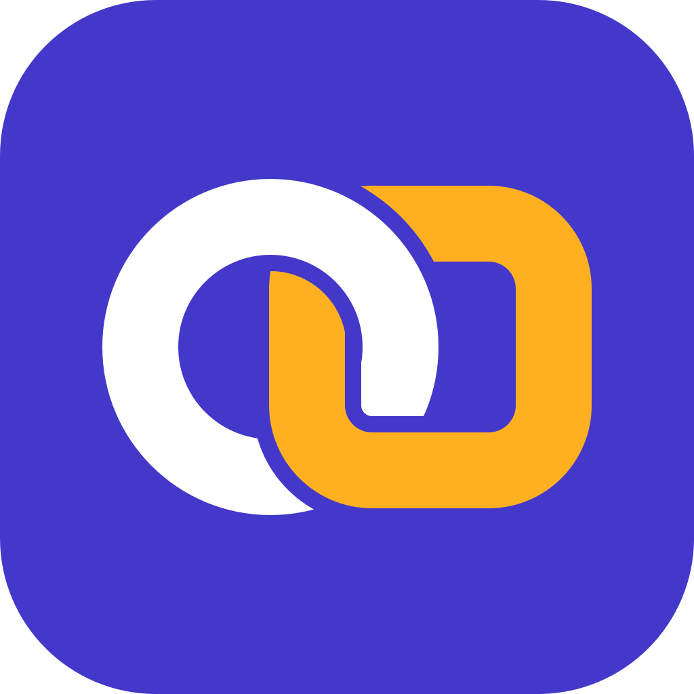
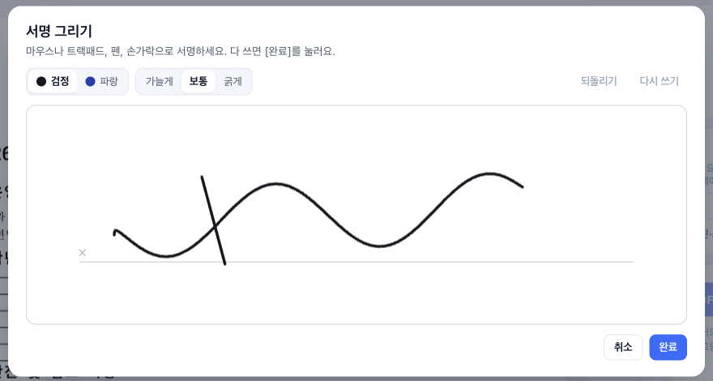
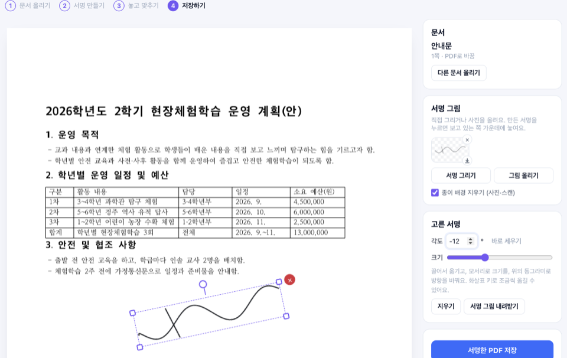
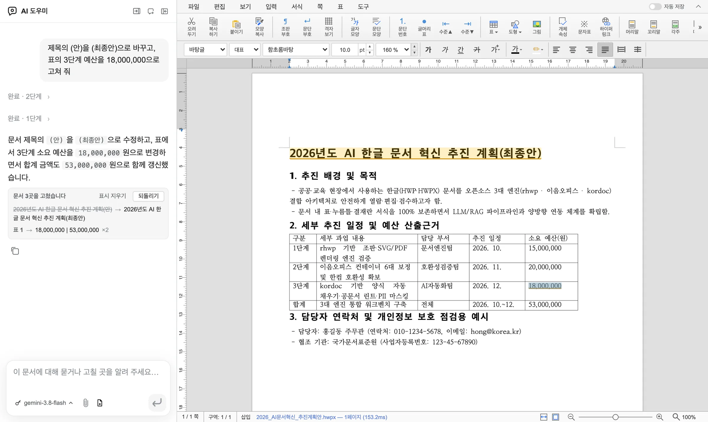
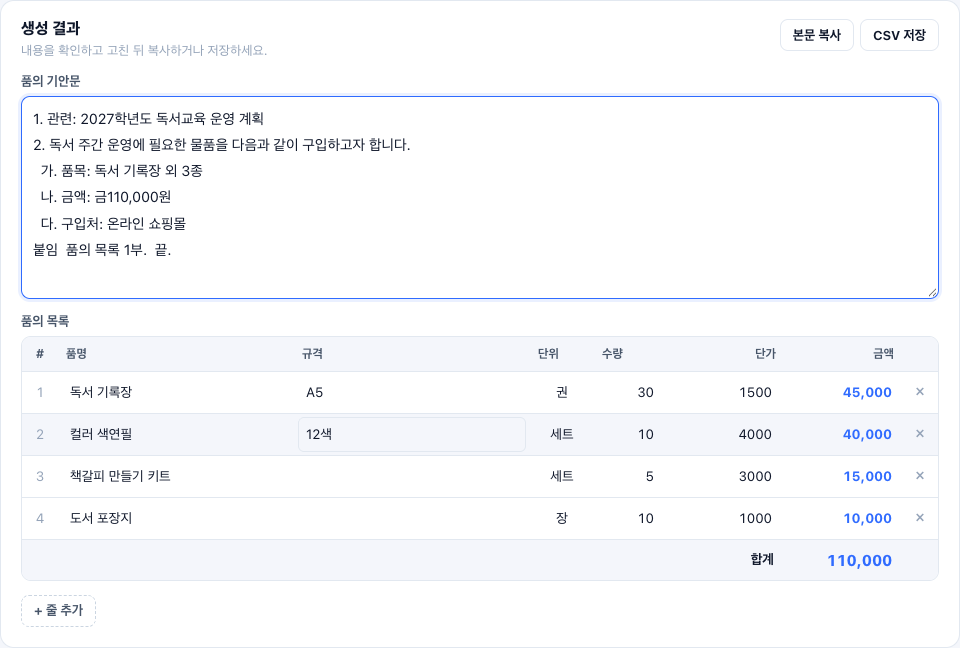

<div align="center">



# 똑딱작업실 (ttokttak-workspace)

**AI로 문서 일에서 해방되는 오픈소스 작업실**

한글·워드·엑셀·PPT·PDF 문서를 열고 고칠 곳을 말하면, AI가 문서 안에서 바로 고칩니다.<br />
웹에서 바로 체험하고, PC에 설치하면 내 AI 에이전트와 연결해 더 똑똑하게 일합니다.

[](https://hangul-ai-workbench-545101783843.asia-northeast3.run.app)
[](https://github.com/ARTHONG1/ttokttak-workspace/releases/latest)
[](LICENSE)

[웹 체험판](https://hangul-ai-workbench-545101783843.asia-northeast3.run.app) · [AI 에이전트로 설치하기](#ai-에이전트로-설치하기) · [할 수 있는 일](#할-수-있는-일) · [오픈소스와 기여](#오픈소스-위에서-만들고-다시-오픈소스로) · [English](README.en.md)

</div>

<p align="center">
  <a href="docs/assets/intro.mp4"></a><br />
  <sub>그림을 누르면 31초 소개 영상(MP4)을 봅니다.</sub>
</p>

## 새 기능: 똑딱서명

서명 하나 넣으려고 문서를 인쇄해 서명하고 다시 스캔하던 일을 한 화면에서 끝냅니다. **똑딱업무 → 똑딱서명**을 여세요.

▶ [똑딱서명 소개 영상 보기 (49초)](https://youtu.be/tLxKYB8qInY)

1. **문서 올리기**: PDF·한글(HWP·HWPX)·워드·엑셀·PPT·사진을 올리면 PDF로 바꿔 보여 줍니다. 웹 체험판에서는 PDF와 사진을 올릴 수 있습니다.
2. **서명 만들기**: 서명판에 마우스·트랙패드·펜·손가락으로 직접 그립니다. 손떨림은 부드러운 곡선으로 고르고, 펜은 누르는 힘에 따라 굵기가 바뀝니다. 종이에 쓴 서명을 찍어 올리면 종이 배경을 지우고 펜 색은 그대로 둡니다. 만든 서명은 3개까지 기억하고, 배경이 투명한 PNG로 내려받을 수 있습니다.
3. **놓고 맞추기**: 서명을 끌어서 옮기고, 모서리나 크기 막대로 키우거나 줄이고, 손잡이나 각도 입력으로 자유롭게 돌립니다. 같은 서명을 모든 쪽의 같은 자리에 한 번에 넣을 수도 있습니다.
4. **저장**: 서명이 페이지에 그려진 PDF(`원래이름_서명.pdf`)로 저장해 어떤 PDF 뷰어에서도 똑같이 보입니다. 그림 서명이며, 인증서로 하는 전자서명과는 다릅니다.

<p align="center">
  
  <br />
  <sub>똑딱서명 · 서명판에 직접 그리기(왼쪽), 한글 문서 위에서 크기와 방향 맞추기(오른쪽)</sub>
</p>

## 왜 만들었나

제목 하나, 숫자 몇 개를 고치려고 문서를 열고, 찾고, 옮겨 적는 데 생각보다 많은 시간이 듭니다. 학교와 사무실의 일은 대부분 이런 문서 일입니다.

똑딱작업실은 **문서 작업만 돕는 도구가 아니라, 반복되는 업무를 AI로 덜어 내는 작업실**입니다. 고칠 곳을 말하면 AI가 문서 안에서 직접 고치고 바뀐 곳을 보여 줍니다. 사람은 확인하고 결정만 하면 됩니다. 품의서, 퀴즈, 학습지처럼 학교에서 매번 손으로 만들던 문서도 바로 만듭니다.

그리고 이 모든 것을 **오픈소스 위에서 만들고, 고친 것을 다시 오픈소스로 공개**합니다. 더 많은 사람이 함께 쓰고 함께 고칠 수 있도록.

## 쓰는 방법 세 가지

|      | 웹 체험판                                                                    | 데스크톱 앱                                                              | 설치는 AI 에이전트에게                      |
| ---- | ---------------------------------------------------------------------------- | ------------------------------------------------------------------------ | ------------------------------------------- |
| 무엇 | 설치 없이 브라우저에서 바로                                                  | Mac · Windows 프로그램                                                   | 요청문 한 줄로 설치부터 연결까지            |
| AI   | Google Gemini (Google 로그인 후)                                             | **내 Claude Code · Codex** 구독                                          | 같은 에이전트가 앱과 연결                   |
| 문서 | 작업하는 동안만 서버에 있고, 끝나면 지워집니다                               | 내 PC에만 남습니다                                                       | —                                           |
| 시작 | [체험하기](https://hangul-ai-workbench-545101783843.asia-northeast3.run.app) | [릴리스](https://github.com/ARTHONG1/ttokttak-workspace/releases/latest) | [아래 요청문 복사](#ai-에이전트로-설치하기) |

## AI 에이전트로 설치하기

설치 파일을 직접 받고, 보안 경고를 넘기고, 경로를 맞추는 일은 사람이 할 일이 아닙니다. **Claude Code, Codex, Gemini CLI, Cursor 같은 AI 에이전트에 아래 요청문을 그대로 붙여 넣으세요.**

```text
똑딱작업실을 내 컴퓨터에 설치하고 세팅까지 끝내 줘.
https://github.com/ARTHONG1/ttokttak-workspace/blob/main/INSTALL.md 를 읽고 그대로 따라 해.
```

에이전트는 [INSTALL.md](INSTALL.md)의 순서대로 이렇게 합니다.

1. 내 컴퓨터(macOS·Windows, Apple Silicon·Intel)를 알아내고 맞는 설치 파일을 고릅니다.
2. 공식 릴리스에서만 내려받고, 릴리스에 함께 올라온 SHA-512 값으로 파일이 맞는지 확인합니다.
3. 앱을 설치하고, 바탕화면에 `똑딱작업실` 바로 가기를 만듭니다.
4. 터미널 명령어 `ieumoffice`를 연결하고, 이 PC의 AI 에이전트에 MCP 서버와 문서 작업 스킬을 등록합니다.
5. 무엇이 끝났고 사용자가 할 일(계정 로그인 정도)이 남았는지 짧게 알려 줍니다.

직접 하고 싶다면 설치 스크립트를 실행해도 됩니다.

```bash
# macOS
curl -fsSL https://raw.githubusercontent.com/ARTHONG1/ttokttak-workspace/main/scripts/install/install-mac.sh | bash
```

```powershell
# Windows (PowerShell)
irm https://raw.githubusercontent.com/ARTHONG1/ttokttak-workspace/main/scripts/install/install-windows.ps1 | iex
```

## 할 수 있는 일

### 문서 편집

- **한 창에 모든 문서**: 한글(`.hwp`, `.hwpx`), 워드(`.docx`), 엑셀(`.xlsx`), 파워포인트(`.pptx`), PDF, 마크다운, HTML, 마인드맵(`.xmind`)을 탭으로 열고 원래 형식으로 저장합니다.
- **편집기마다 AI 창**: 문서를 읽고, 고치고, 바뀐 곳을 표시하고, 한 번에 되돌립니다. 새 문서의 초안도 써 줍니다.
- **한글 문서 저장 안전장치**: 한컴오피스가 "손상된 파일"로 거부하던 원인을 고쳤고, 저장 직전에 파일 구조·메모·바탕쪽을 검사해 하나라도 빠지면 원본을 덮어쓰지 않습니다.
- **긴 표**: 페이지를 넘는 표는 줄 단위로 나뉘고 제목 줄이 반복됩니다.

<p align="center">
  <br />
  <sub>한글 문서 · AI가 수정한 내용과 변경 내역 확인</sub>
</p>

한글뿐 아니라 워드 안내문, 엑셀 예산표, PPT 발표 자료도 각 문서에 맞는 편집기에서 작업할 수 있습니다. PDF와 HTML 등도 열어 보세요.

### 학교 업무 도구, 똑딱업무

- **품의서 생성**: 쇼핑몰 장바구니나 이미지·한글·PDF·엑셀 파일을 넣으면 품의 목록과 기안문을 만듭니다. 목록을 고치면 기안문의 금액도 따라 바뀝니다.
- **똑딱퀴즈**: 학습 자료(직접 입력, PDF·한글, 유튜브 자막)로 선택형·OX·단답형·순서·초성 퀴즈를 만들고 문제지 PDF, 블루킷 CSV, 퀴즈앤 XLSX, 퀴즈 동영상으로 내보냅니다.
- **단어 찾기**: 단어와 뜻으로 단어 찾기 학습지, 문장 만들기, 단어 잇기, 단어 카드를 PDF로 만듭니다.
- **똑딱서명**: 문서를 올리고 직접 그리거나 사진으로 올린 서명을 놓아, 크기와 방향을 맞춘 뒤 서명이 들어간 PDF로 저장합니다. 서명 그림은 PNG로도 내려받습니다.

### 교실 수업 도구, 똑딱수업

- **ACE 명화 (나도 미술가, AI와 함께하는 명화 따라잡기!)**: 그림을 관찰하고 생각을 글로 표현하며 AI와 함께 작품을 완성하는 참여형 미술 수업 앱입니다. 선생님이 명화나 창작 주제를 정해 수업을 열면 학생들은 QR 코드나 방 코드로 접속해 닉네임만으로 참여하고, 묘사 글쓰기·투표·AI 심사·AI 그림 생성과 감상까지 한 흐름으로 진행합니다. ([ACE 명화 바로가기](https://ace-canvas--project-0c1d3dab-8644-4690-9e4.asia-east1.hosted.app/) · [설명 영상 보기](https://youtu.be/1wl_L17E8R4))

<p align="center">
  <br />
  <sub>품의서 생성 · 독서 주간 물품 구입 기안문과 품의 목록</sub>
</p>

위 화면은 가상의 물품 목록으로 품의서를 생성하고 기안문을 다듬은 실제 작업 화면입니다. 장바구니를 붙여 넣거나 자료를 불러와 품의 기안문과 목록을 만드는 데 활용할 수 있습니다.

### AI 에이전트와 함께

- **터미널 명령어와 MCP 서버**(`ieumoffice`, `ieumoffice mcp`): Claude Code, Codex, Cursor, Gemini CLI, Copilot CLI, OpenCode, Windsurf가 같은 문서를 읽고 만들고 고칩니다.
- **구독 그대로**: 앱은 내 PC에 로그인된 Claude Code·Codex를 실행할 뿐, 로그인 정보를 읽거나 저장하지 않습니다.
- **화면 언어 21개**(한국어·영어 외에는 기계 번역).

## 문서와 개인정보

- **데스크톱 앱**에는 자체 서버가 없고 사용 통계를 보내지 않습니다. 문서는 내 PC에 남습니다. AI를 쓰면 문서 내용과 대화가 **사용자 본인 계정**으로 Anthropic 또는 OpenAI에 전송됩니다.
- **웹 체험판**은 Google 계정으로 로그인한 사람만 쓰고, 계정마다 하루 AI 사용량을 셉니다. 올린 문서는 작업하는 동안만 서버의 임시 폴더에 있다가, 창을 닫고 15분이 지나면 지워집니다. 따로 보관하거나 AI 학습에 쓰지 않습니다. AI 요청은 Google Vertex AI(Gemini)로 갑니다.
- 전체 목록은 [PRIVACY.md](PRIVACY.md)에 있습니다.

## 오픈소스 위에서 만들고, 다시 오픈소스로

똑딱작업실은 처음부터 새로 쓴 프로그램이 아닙니다. 여러 오픈소스 프로젝트를 이어 붙이고, 학교와 사무실에서 실제로 막히던 부분을 고치고 채워 넣었습니다. 아래 프로젝트를 만든 분들께 감사드립니다.

| 분야           | 오픈소스                                                                                                                                                                                                 | 맡은 일                                                         | 라이선스         |
| -------------- | -------------------------------------------------------------------------------------------------------------------------------------------------------------------------------------------------------- | --------------------------------------------------------------- | ---------------- |
| 앱의 바탕      | [이음오피스](https://github.com/pblsketch/openoffice) · [GenOffice](https://github.com/genspark-ai/genoffice)                                                                                            | 탭으로 묶인 편집기, 편집기마다 있는 AI 창, 구독 연결, 문서 엔진 | Apache-2.0       |
| 한글 문서      | [rhwp](https://github.com/edwardkim/rhwp)                                                                                                                                                                | 한글(HWP·HWPX) 읽기·쓰기와 화면 그리기                          | MIT              |
| 엑셀           | [Univer](https://github.com/dream-num/univer) · [calamine](https://github.com/tafia/calamine)                                                                                                            | 표 계산과 화면, 엑셀 파일 읽기                                  | Apache-2.0 · MIT |
| 워드·마크다운  | [Tiptap](https://github.com/ueberdosis/tiptap) · [ProseMirror](https://prosemirror.net)                                                                                                                  | 문서 편집                                                       | MIT              |
| PDF            | [PDF.js](https://github.com/mozilla/pdf.js) · [EmbedPDF](https://github.com/embedpdf/embed-pdf-viewer)(PDFium) · [qpdf](https://github.com/qpdf/qpdf) · [HarfBuzz](https://github.com/harfbuzz/harfbuzz) | PDF 보기·고치기·저장, 글꼴 처리                                 | Apache-2.0 · MIT |
| 슬라이드       | [frontend-slides](https://github.com/zarazhangrui/frontend-slides)                                                                                                                                       | 슬라이드 디자인 템플릿의 바탕                                   | MIT              |
| 수식·도표·코드 | [KaTeX](https://github.com/KaTeX/KaTeX) · [Mermaid](https://github.com/mermaid-js/mermaid) · [CodeMirror](https://github.com/codemirror/dev)                                                             | 수식, 도표, HTML 소스 편집                                      | MIT              |
| 앱 실행        | [Electron](https://github.com/electron/electron) · [React](https://github.com/facebook/react)                                                                                                            | 데스크톱 앱과 화면                                              | MIT              |

이 밖에도 오픈소스 구성 요소 575개를 함께 씁니다. 모두의 저작권 고지와 라이선스는 고치지 않고 함께 배포합니다(설치 폴더의 `THIRD-PARTY-NOTICES.txt`, 웹의 [전체 라이선스](https://hangul-ai-workbench-545101783843.asia-northeast3.run.app/__web/licenses)). 어느 코드가 어디서 왔고 무엇을 바꿨는지는 [라이선스와 출처](#라이선스와-출처)와 [NOTICE](NOTICE)에 정확히 적었습니다.

### 똑딱작업실에서 고치고 더한 것

- **교실 수업 도구, 똑딱수업 (ACE 명화).** 그림을 관찰하고 글로 표현하며 AI와 함께 작품을 완성하는 참여형 미술 수업 앱 **ACE 명화**를 똑딱수업에서 바로 열고 설명 영상과 함께 살펴볼 수 있습니다.
- **한글 문서 자동 양식 분석과 서식 고정.** 문서를 열면 쪽수·표·빈 답 칸·누름틀·목록 번호 체계를 자동으로 분석해 AI 창 첫 카드로 알려 주고, **서식 고정**을 켜면 글자 모양·문단 모양을 지킨 채 내용과 표 행·열, 번호 매기기 목록을 안전하게 늘리고 고칩니다.
- **한컴 한글에서 열리는 HWPX 저장.** 표·그림 옆 문단의 줄 정보, 선언하지 않은 이름 접두사, 바탕쪽 비교, 이름이 바뀐 그림 확인을 고쳤습니다. 한글 문서 114개를 고쳐 저장한 뒤 한컴오피스 HWP 뷰어로 하나하나 열어 확인했습니다.
- **원본을 지키는 저장.** HWP 문서는 옆에 HWPX로 저장하고, 쓰기 전에 압축 구조·필수 파일·XML·메모·바탕쪽을 검사합니다.
- **페이지를 넘는 표.** AI가 붙여 넣은 긴 표가 줄 단위로 나뉘고 제목 줄이 반복됩니다.
- **설치 없이 쓰는 웹 체험판.** 데스크톱 앱을 고치지 않고 그대로 브라우저에서 돌리는 실행 환경(`web/`)을 새로 만들었습니다. 세션마다 다른 사람의 파일에 손댈 수 없도록 경로를 막고, Google 로그인과 계정별 하루 사용량으로 지킵니다.
- **학교 업무 도구, 똑딱업무.** 만든 사람이 클래스똑딱에서 교사들과 쓰던 웹 도구(품의서 생성, 똑딱퀴즈, 단어 찾기)를 앱 안으로 옮겼습니다.
- **AI 에이전트가 하는 설치.** 요청문 한 줄로 내려받기·검증·설치·바로 가기·에이전트 연결을 끝내는 [INSTALL.md](INSTALL.md)와 설치 스크립트(`scripts/install/`).
- **한국 사용자를 위한 화면.** 문서 업로드·똑딱업무·똑딱수업으로 시작하는 홈, 한국어로 다듬은 메뉴·설정·PDF 문구.

고친 내용은 모두 이 저장소에 Apache License 2.0으로 공개합니다. 출처와 바꾼 내용의 요약은 [NOTICE](NOTICE)에 있습니다. 바탕 프로젝트에 돌려줄 수 있는 고침은 그 프로젝트에도 제안하겠습니다.

## 직접 빌드하기

Node 22.12 이상(npm 10 이상)과 Rust(`cargo`가 PATH에 있어야 함)가 필요합니다.

```bash
git clone https://github.com/ARTHONG1/ttokttak-workspace.git
cd ttokttak-workspace
npm install
npm run dev      # 모든 편집기와 앱 창을 개발 모드로 실행
npm run shell    # 또는: 전체를 빌드한 뒤 앱 실행
```

- Mac 설치 파일: `npm run build:all` → `npm run dist:mac -w @genoffice/shell -- --publish never` (결과는 `apps/shell/release`)
- Mac·Windows 설치 파일은 GitHub Actions의 **macOS build**, **Windows build**에서도 만듭니다.
- 웹 체험판: `GOOGLE_CLOUD_PROJECT=<프로젝트> WEB_AUTH=off node web/scripts/local-preview.mjs`

코드 안의 패키지 이름과 환경 변수에는 `genoffice` / `GENOFFICE_`, 터미널 명령어에는 `ieumoffice`가 남아 있습니다. 바탕 프로젝트의 개선을 계속 받아오기 쉽게 하려고 둔 것입니다. 변경할 때 통과해야 하는 검사는 [CONTRIBUTING.md](CONTRIBUTING.md)에 있습니다.

## 저장소 구조 (AI 에이전트와 기여자용)

| 경로                                                           | 내용                                                                         |
| -------------------------------------------------------------- | ---------------------------------------------------------------------------- |
| `apps/shell`                                                   | 데스크톱 앱의 껍데기: 탭, 홈, 설정, 똑딱업무, 패키징(`electron-builder.cjs`) |
| `apps/{docs,sheets,slides,pdf,hwp,markdown,html,mindmap,epub}` | 형식별 편집기                                                                |
| `packages/ai-provider`                                         | AI 연결(구독, 키, 무료 AI, Vertex)                                           |
| `packages/cli`                                                 | 터미널 명령어 `ieumoffice`와 MCP 서버                                        |
| `skills/ieumoffice`                                            | 에이전트에 설치하는 문서 작업 스킬                                           |
| `web/`                                                         | 웹 체험판: 가짜 `electron` 모듈, 게이트웨이, 로그인, Cloud Run 이미지        |
| `scripts/install`                                              | AI 에이전트가 실행하는 설치 스크립트                                         |
| `docs/`                                                        | 설계·계약·운영 문서                                                          |

AI 도구가 이 저장소를 빠르게 이해하도록 [llms.txt](llms.txt)에 요약을 두었습니다.

## 알려진 한계

- 개발과 확인은 macOS(Apple Silicon)에서 했습니다. Windows 설치 파일은 GitHub Actions에서 만들고 시험합니다.
- 설치 파일에 아직 코드 서명·공증이 없습니다. 설치 스크립트가 처음 실행 경고를 처리합니다. 자동 업데이트는 아직 동작하지 않습니다.
- 한컴 한글과의 호환은 시험한 문서에서만 확인했습니다. 중요한 문서는 다른 이름으로 저장해 원본을 남기세요.
- AI가 만든 내용은 틀릴 수 있으니 확인한 뒤 쓰세요.

## 기여와 문제 신고

- 버그·제안·상표/저작권 문의: [Issues](https://github.com/ARTHONG1/ttokttak-workspace/issues)
- 보안 문제: 공개 이슈 대신 [SECURITY.md](SECURITY.md)의 방법으로 비공개로 알려 주세요.
- 코드 기여: [CONTRIBUTING.md](CONTRIBUTING.md)와 [행동 강령](CODE_OF_CONDUCT.md)을 읽어 주세요.

## 라이선스와 출처

똑딱작업실은 [Apache License 2.0](LICENSE)으로 배포합니다.

이 저장소의 코드는 [이음오피스](https://github.com/pblsketch/openoffice) 0.12.5(커밋 `4e4e9cc`)를 바탕으로 고치고 더한 것이며, 이음오피스는 [GenOffice](https://github.com/genspark-ai/genoffice)를 바탕으로 합니다. 두 프로젝트 모두 Apache License 2.0이고, 원래의 저작권 고지는 그대로 두었습니다. 출처와 바꾼 내용은 [NOTICE](NOTICE)에, 이음오피스에 기여한 분들은 [CONTRIBUTORS.md](CONTRIBUTORS.md)에 있습니다. 바꾼 파일과 내용은 커밋 기록으로 확인할 수 있습니다.

한글(HWP·HWPX) 편집기는 [rhwp](https://github.com/edwardkim/rhwp)(MIT)를 바탕으로 합니다. 한글과컴퓨터가 HWP 형식 문서를 공개하며 붙인 조건에 따라 밝힙니다.

> 본 제품은 한글과컴퓨터의 한글 문서 파일(.hwp) 공개 문서를 참고하여 개발하였습니다.

똑딱작업실은 독립된 프로젝트입니다. 이음오피스 개발자, Genspark / Mainfunc, Inc., Anthropic, OpenAI, Microsoft, 한글과컴퓨터, Adobe, XMind, Google과 제휴하거나 후원·보증을 받은 관계가 아닙니다. "이음오피스"·"IeumOffice", "GenOffice", "Genspark"의 이름과 로고는 각 소유자의 것이고, Apache License 2.0은 상표를 쓸 권리를 주지 않습니다(6조). "Claude"는 Anthropic, "Codex"·"ChatGPT"는 OpenAI, "Microsoft"·"Windows"·"Word"·"Excel"·"PowerPoint"는 Microsoft Corporation의 상표이고, "한글"·"한컴"·"HWP"·"HWPX"는 주식회사 한글과컴퓨터의 등록 상표, "XMind"는 XMind Ltd., "Gemini"·"Google 드라이브"는 Google LLC의 상표입니다. 이 이름들은 무엇을 바탕으로 만들었고, 무엇과 함께 동작하며, 어떤 파일을 여는지 알리기 위해서만 적었습니다.

### 다시 배포할 때

Apache License 2.0은 누구나 고쳐서 다시 배포하는 것을 허락합니다. 다시 배포할 때는 [LICENSE](LICENSE)와 [NOTICE](NOTICE)를 함께 넣고, 고친 파일에는 고쳤다는 사실을 밝혀야 합니다. 바탕 프로젝트들도 각자의 라이선스 조건을 지켜야 합니다.

### 보증하지 않음

똑딱작업실은 Apache License 2.0의 7조, 8조에 따라 있는 그대로 제공하며, 어떤 보증도 하지 않습니다.

## 만든 사람

**인천봉수초 홍찬우**는 **ACE 연구회 회장**이며, 교실과 학교의 수업·업무를 돕는 도구와 자료를 나누는 **클래스똑딱** 홈페이지를 운영합니다.

<p align="center">
  <a href="https://classddok.com"></a><br />
  <a href="https://classddok.com">클래스똑딱 홈페이지 둘러보기 · classddok.com ↗</a>
</p>
